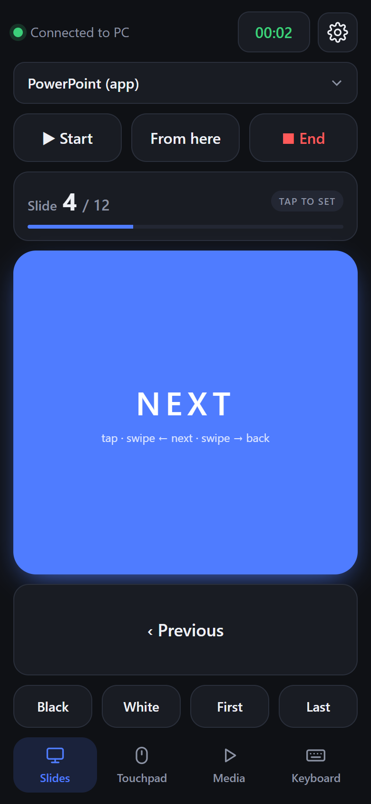
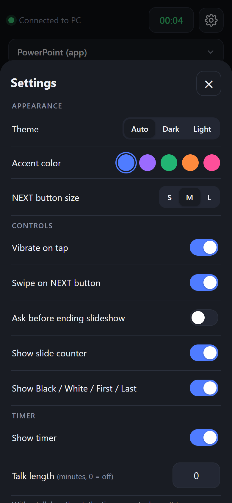
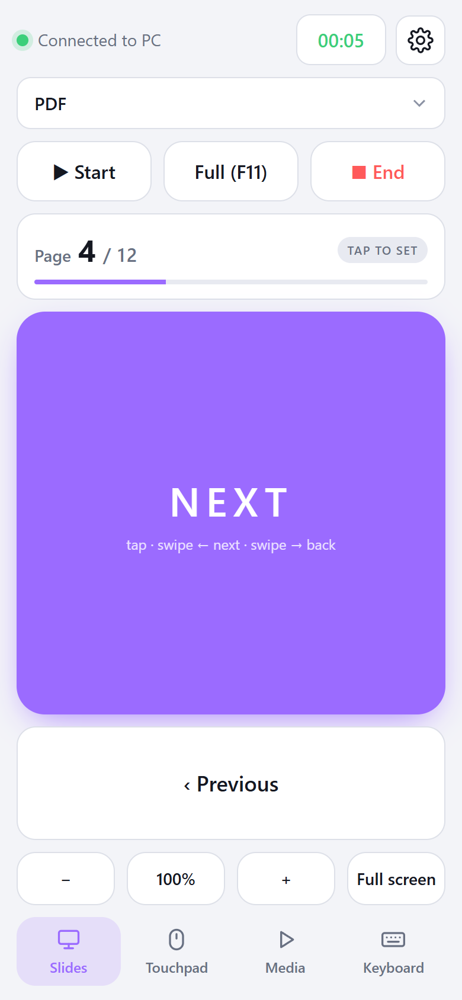

# 📱 Phone Clicker

**Turn your phone into a wireless presentation clicker.** Control PowerPoint, Google Slides, Keynote, PDFs, videos and more from your phone. You don't install anything on the phone.

```
 ┌──────────────┐        same Wi-Fi         ┌──────────────────┐
 │  📱 Phone     │ ───────────────────────▶ │  💻 Laptop        │
 │  (browser)   │   tap NEXT → → →          │  PowerPoint, PDF │
 └──────────────┘                           └──────────────────┘
```

You run a small program on your laptop. It shows a QR code, you scan it with your phone, and your phone's browser becomes the remote.

<p align="center">
  
  
  
</p>

📖 **New here? Read the [full user guide (PDF)](docs/Phone-Clicker-User-Guide.pdf)**. It explains every screen and button with pictures.

---

## Contents

- [Features](#-features)
- [Requirements](#-requirements)
- [Installation](#-installation)
- [Running it](#-running-it)
- [Using it](#-using-it)
- [Troubleshooting](#-troubleshooting)
- [How it works](#-how-it-works)

---

## ✨ Features

| | |
|---|---|
| 🎯 **Slide control** | A big NEXT button (tap it or swipe), Previous, Start, Start from current slide, End |
| 🖥️ **Works with your app** | PowerPoint (desktop and web), Google Slides, Keynote and PDF viewers |
| 🔢 **Slide number** | See which slide you're on. It's read live from PowerPoint on Windows and counted on the phone for other apps |
| ⬛ **Presenter tricks** | Black or white screen, jump to the first or last slide, a countdown timer for your talk |
| 🖱️ **Touchpad** | Use your phone as a wireless mouse, with scrolling and right-click |
| 🎵 **Media keys** | Play/pause, next and previous track, volume, mute, full screen |
| ⌨️ **Keyboard** | Type on your phone and the text appears on the laptop |
| ⚙️ **Settings** | Dark or light theme, accent colors, NEXT button size, vibration, swipe, timer and touchpad speed |
| 🔒 **Private** | Each run creates a new secret link, so others on the Wi-Fi can't control your laptop |
| 📲 **No phone app** | Works in any phone browser (Chrome, Safari, Firefox, Samsung Internet) |

---

## 📋 Requirements

- A **laptop** running Windows 10/11, macOS or Linux (X11)
- **Python 3.9 or newer** on the laptop
- A **phone** with a web browser and a camera to scan the QR code
- The phone and laptop on the **same Wi-Fi network** (a phone hotspot works too)

---

## 📥 Installation

You only do this once.

### Step 1: Install Python

Check whether you already have it. Open a terminal (on Windows, Command Prompt or PowerShell) and run:

```bash
python --version
```

If it prints `Python 3.9` or higher, skip to Step 2. If not:

- **Windows**: download Python from [python.org/downloads](https://www.python.org/downloads/). When the installer opens, **tick "Add python.exe to PATH"** before you click Install.
- **macOS**: download it from [python.org/downloads](https://www.python.org/downloads/), or run `brew install python` if you use Homebrew.
- **Linux**: it's usually already installed. Otherwise run `sudo apt install python3 python3-venv`.

### Step 2: Download Phone Clicker

**Option A, with Git:**

```bash
git clone https://github.com/YOUR-USERNAME/phone-clicker.git
```

**Option B, without Git:** on the GitHub page, click the green **Code** button, choose **Download ZIP**, and unzip the folder somewhere easy to find, such as your Desktop.

### Step 3: First-time setup

The start scripts set everything up automatically the first time you run them, so you can go straight to [Running it](#-running-it).

<details>
<summary><b>Prefer to set it up manually?</b></summary>

```bash
cd phone-clicker
python -m venv .venv

# Windows
.venv\Scripts\pip install -r requirements.txt

# macOS / Linux
.venv/bin/pip install -r requirements.txt
```

</details>

---

## ▶️ Running it

### Windows

Double-click **`start.bat`** in the `phone-clicker` folder.

> The first run takes about a minute while it installs. After that it starts instantly.
>
> **Windows Firewall will pop up and ask about Python. Tick "Private networks" and click Allow.** If you skip this, your phone won't be able to connect.

### macOS / Linux

Open a terminal in the `phone-clicker` folder and run:

```bash
./start.sh
```

If you get "permission denied", run `chmod +x start.sh` once and try again.

> **macOS:** the first time, go to **System Settings → Privacy & Security → Accessibility** and turn on the app you launched it from (Terminal, iTerm or VS Code). Without this, macOS blocks the key presses.

### What you'll see

A browser tab opens on your laptop with a big QR code. The same QR code and a link are also printed in the terminal:

```
Scan this with your phone (same Wi-Fi as this laptop):

  █▀▀▀▀▀█ ▄▀▄ █▀▀▀▀▀█
  █ ███ █ ▀█▄ █ ███ █
  ...

Or open: http://192.168.0.8:8765/?t=Ab3xYz9Qk
Press Ctrl+C to stop.
```

**Keep this window open** while you present. To stop Phone Clicker, close it or press `Ctrl+C`.

### Options

```bash
python server.py --port 9000      # use a different port
python server.py --no-browser     # don't open the QR page on the laptop
```

---

## 🎤 Using it

### Connect your phone

1. Open your phone's **camera** and point it at the QR code.
2. Tap the link that pops up. The remote opens in your browser.
3. Check that the **dot in the top-left corner is green**. That means you're connected.

> 💡 **Tip:** the link changes every time you restart Phone Clicker, so scan the QR code again after a restart.

### Give a presentation

1. On the laptop, **open your presentation** and **click on it once** so it's the active window.
2. On the phone, **choose your app** from the dropdown at the top (for example *PowerPoint (app)*).
3. Tap **▶ Start**. The slideshow starts and the timer begins.
4. Tap the big **NEXT** button to go forward. You can also swipe left on it, or swipe right to go back.
5. Tap **■ End** when you're done.

> ⚠️ Phone Clicker sends key presses to **whichever window is active** on the laptop. If nothing happens, click on your presentation once.

### The four tabs at a glance

| Tab | What it's for | Use it when... |
|---|---|---|
| 🎯 **Slides** | Start, move through and end a slideshow. Shows the slide number and a timer | You're presenting slides or a PDF. This is the tab you'll use 90% of the time |
| 🖱️ **Touchpad** | Turns your phone into a wireless mouse (drag, tap, scroll, right-click) | You need to click a link, play an embedded video or open a file mid-talk |
| 🎵 **Media** | Play/pause, volume, full screen, zoom, switch app, arrow keys | You're showing a YouTube video, playing music, or zooming into something |
| ⌨️ **Keyboard** | Type on your phone and the text appears on the laptop | You need to search, type a URL or fill in a box without walking to the laptop |

#### Slide number

The card above NEXT shows **Slide 4 / 12** and a progress bar.

- **PowerPoint on Windows:** the number is read **live** from PowerPoint (green **LIVE** badge), so it's always right, even with animations.
- **Every other app:** the phone counts your taps. Tap the card to set the current slide or the total number of slides.

#### Settings ⚙️

Tap the gear icon in the top-right corner to change:

- **Appearance:** dark, light or auto theme, five accent colors, and the NEXT button size (S, M or L)
- **Controls:** vibration, swipe gestures, ask before ending, and show or hide the slide counter and the extra buttons
- **Timer:** set a talk length and the timer counts down, turns orange in the last 2 minutes, and turns red with a buzz when time is up
- **Touchpad:** pointer speed, scroll speed and natural scrolling

Your settings are saved on your phone.

> 📖 **Want every button explained?** Read the full **[Phone Clicker User Guide (PDF)](docs/Phone-Clicker-User-Guide.pdf)**.

### App guide

Choose the matching app in the dropdown so **Start** sends the right shortcut:

| App | How to set it up | Start | From here |
|---|---|---|---|
| **PowerPoint (app)** | Open the .pptx file | F5 · ⌘⇧↩ on Mac | Shift+F5 · ⌘↩ on Mac |
| **PowerPoint (web)** | Open it at office.com in your browser | Ctrl+F5 | – |
| **Google Slides** | Open the deck in your browser | Ctrl+Shift+F5 · ⌘⇧↩ on Mac | Ctrl+F5 · ⌘↩ on Mac |
| **Keynote** (Mac only) | Open the .key file | ⌥⌘P | – |
| **PDF** | Open it in Adobe Acrobat/Reader, Edge, Chrome or Preview | Ctrl+L / ⌘L (Acrobat full screen) | F11 / ⌃⌘F (browser and Preview full screen) |

For PDFs, NEXT and Previous use **Page Down / Page Up**, which works in every PDF viewer.

**Other apps:** Canva, Prezi, reveal.js, image viewers and anything else that moves forward with the arrow keys work too. Pick *PowerPoint (app)* and use NEXT and Previous.

---

## 🛠️ Troubleshooting

<details>
<summary><b>My phone can't open the page or the dot stays red</b></summary>

- Make sure the phone and laptop are on the **same Wi-Fi**. Turn off mobile data on the phone to be sure.
- **Guest, hotel, school and office Wi-Fi** often block devices from talking to each other. Instead, turn on your **phone's hotspot** and connect the laptop to it.
- **Windows Firewall:** open *Windows Security → Firewall & network protection → Allow an app through firewall*, find **Python**, and tick **Private**. Also check that your Wi-Fi is set to *Private* rather than *Public* in Windows network settings.
- Make sure the Phone Clicker window is still open on the laptop.

</details>

<details>
<summary><b>The dot is green but nothing happens on the laptop</b></summary>

- Click on your presentation window so it's active. Key presses go to the active window.
- Check that you picked the right app in the dropdown.
- **macOS:** grant Accessibility permission (see [Running it](#-running-it)).
- **Linux:** Phone Clicker needs an **X11** session. Wayland blocks programs from sending key presses. Choose "Ubuntu on Xorg" (or similar) on the login screen.

</details>

<details>
<summary><b>"Start" doesn't start the slideshow</b></summary>

Some browsers and apps grab certain shortcuts. Start the slideshow by hand on the laptop, then use NEXT and Previous from your phone. These use plain arrow keys and work everywhere.

</details>

<details>
<summary><b>My phone screen keeps turning off</b></summary>

Browsers only let pages keep the screen awake over HTTPS, so raise your phone's **auto-lock / screen timeout** while you present. When the screen comes back on, the remote reconnects automatically.

</details>

<details>
<summary><b>"python is not recognized" on Windows</b></summary>

Python wasn't added to PATH. Run the Python installer again, choose **Modify**, and tick **"Add Python to environment variables"**. Or reinstall it and tick **"Add python.exe to PATH"**.

</details>

<details>
<summary><b>Port already in use</b></summary>

Another program is using port 8765. Run `python server.py --port 9000` (or any other free port).

</details>

---

## ⚙️ How it works

```
Phone browser ──WebSocket over Wi-Fi──▶ server.py ──pynput──▶ key presses / mouse on the laptop
```

| File | Purpose |
|---|---|
| `server.py` | Web and WebSocket server ([aiohttp](https://docs.aiohttp.org)) that turns button presses into key presses and mouse movement ([pynput](https://pynput.readthedocs.io)). On Windows it also reads the current slide from PowerPoint ([pywin32](https://github.com/mhammond/pywin32)) |
| `static/index.html`, `app.js`, `style.css` | The phone remote |
| `static/connect.html` | The QR code page shown on the laptop |
| `start.bat` / `start.sh` | One-click launchers that set things up on the first run |
| `docs/` | The PDF user guide and screenshots |

**Security:** each time it starts, Phone Clicker creates a random secret token and puts it in the QR link. The laptop ignores any connection without that token. The QR page itself only opens on the laptop. Everything stays on your local network, and nothing goes to the internet.

---

## 📄 License

[MIT](LICENSE) © 2026 Yashwanth Nagaraju. Use it, change it and share it freely.
